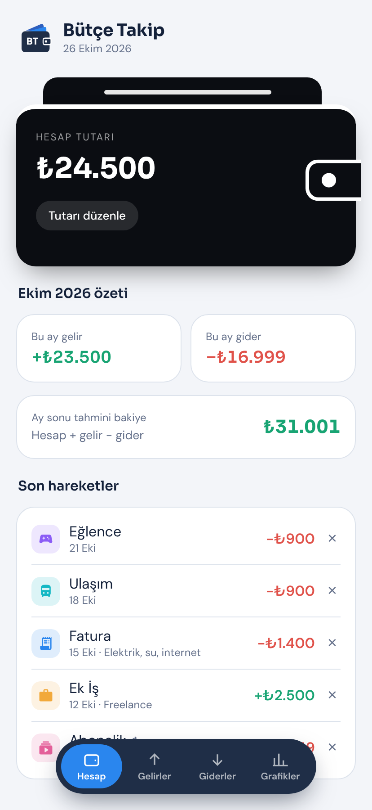
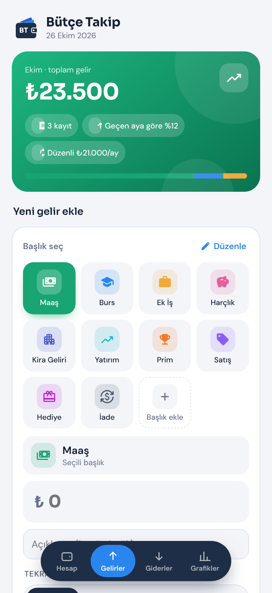
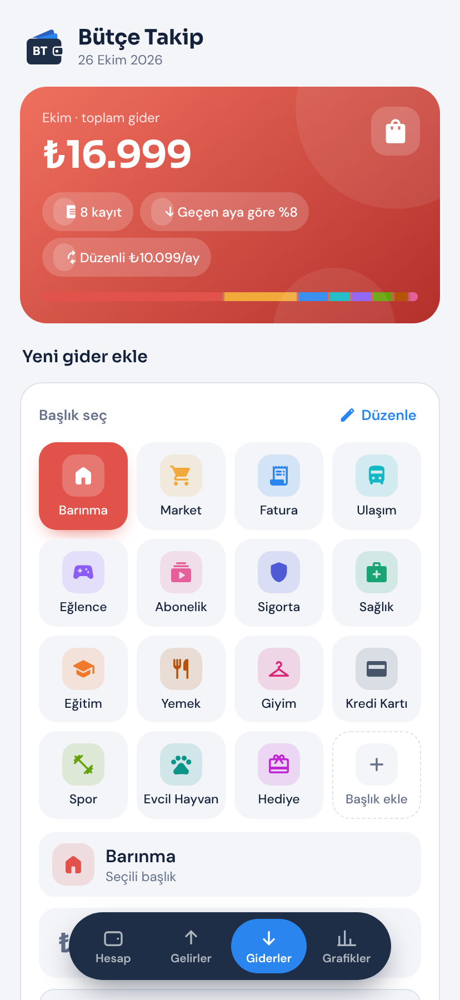
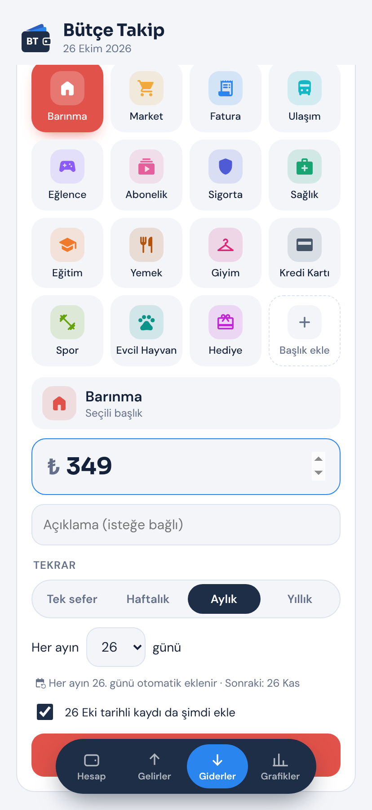
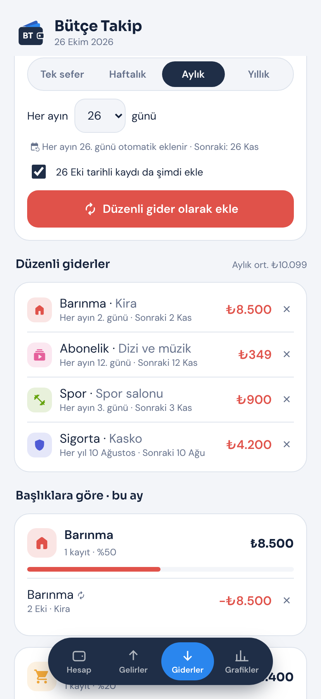
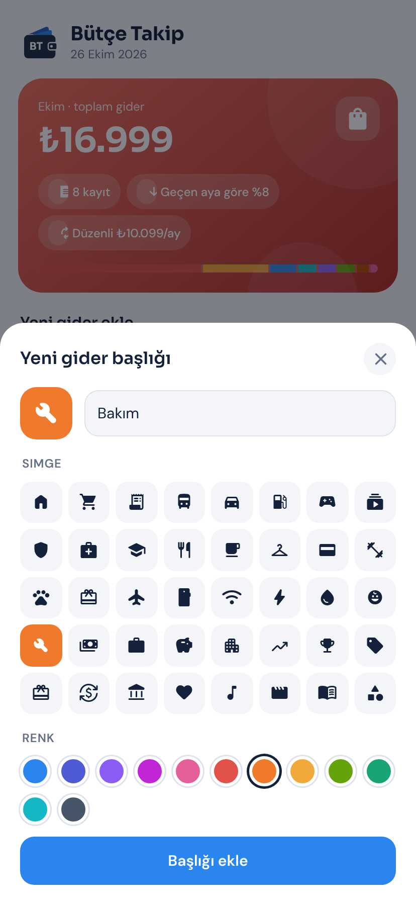
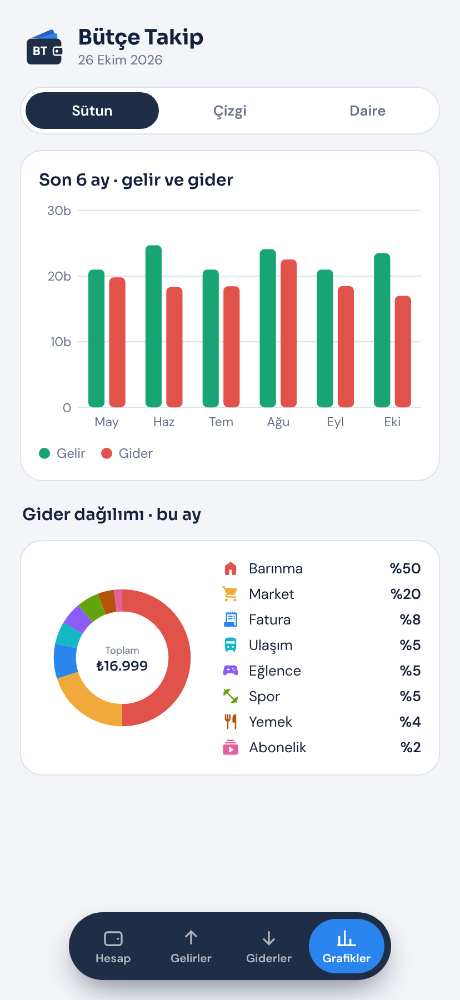
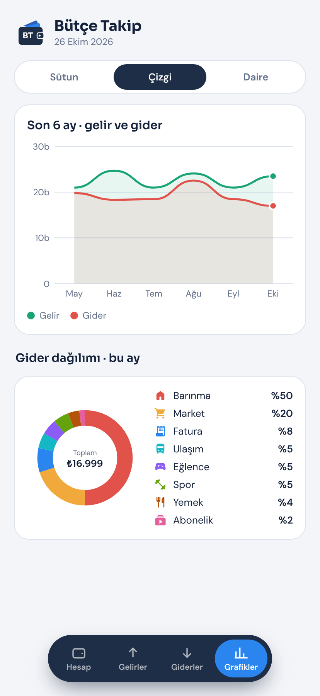
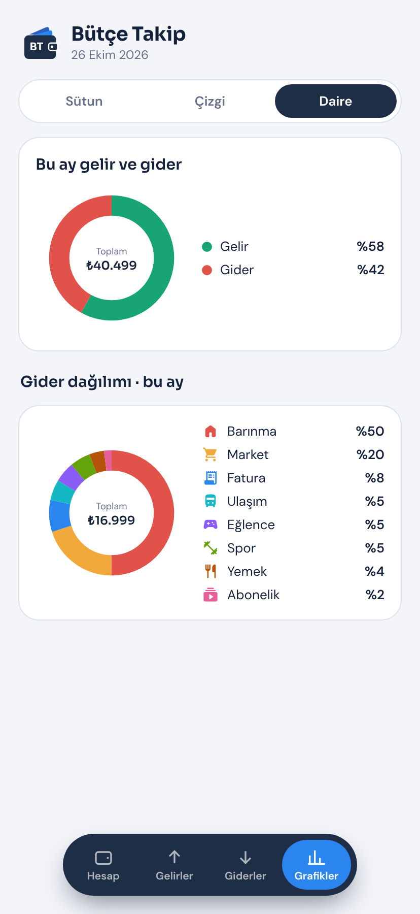

# Bütçe Takip


Flutter ile yazılmış harcama takipçisi. Gelir ve giderleri simgeli başlıklar halinde tutar, düzenli ödemeleri (kira, maaş, abonelik, sigorta) zamanı gelince kendisi ekler, hepsini grafiklerle gösterir.

**[Son sürümün APK'sını indir](../../releases/latest)**

## Ekran görüntüleri

| Hesap | Gelirler | Giderler |
|:---:|:---:|:---:|
|  |  |  |

| Düzenli gider ekleme | Başlıklara göre | Yeni başlık: simge ve renk |
|:---:|:---:|:---:|
|  |  |  |

| Sütun grafik | Çizgi grafik | Daire grafik |
|:---:|:---:|:---:|
|  |  |  |

> Görüntülerdeki tutarlar örnek veridir.

## Özellikler

- **Hesap:** Siyah cüzdan görünümlü kartta hesaptaki para; tutarı kullanıcı girer. Bu ayın gelir ve gider özeti, ay sonu tahmini bakiye, son hareketler.
- **Gelirler / Giderler:**
  - Ayın toplamını, kayıt sayısını, geçen aya göre değişimi ve başlıkların payını gösteren renkli üst kart.
  - Simgeli başlık ızgarası. Hazır gider başlıkları: Barınma, Market, Fatura, Ulaşım, Eğlence, Abonelik, Sigorta, Sağlık, Eğitim, Yemek, Giyim, Kredi Kartı, Spor, Evcil Hayvan, Hediye. Hazır gelir başlıkları: Maaş, Burs, Ek İş, Harçlık, Kira Geliri, Yatırım, Prim, Satış, Hediye, İade.
  - Kendi başlığını ekleme; 40 simge ve 12 renk arasından seçim. "Düzenle" ile var olan başlığın adı, simgesi ve rengi değişir ya da başlık silinir.
  - **Tekrar:** Tek sefer (tarih seçilir), haftalık (gün seçilir), aylık (ayın kaçında olduğu seçilir) veya yıllık. Düzenli kayıtlar zamanı gelince otomatik eklenir; "Düzenli gelirler/giderler" listesinden durdurulabilir.
  - Ayın kayıtları başlıklara göre gruplanır, her başlığın payı çubukla gösterilir.
- **Grafikler:** Son 6 ayın geliri ve gideri aynı tabloda sütun ve çizgi grafik olarak; bu ayın gelir/gider oranı ve giderlerin başlıklara göre dağılımı daire grafiği olarak.
- Altta ortada yüzen pill menü, açık ve koyu tema, Türkçe tarih seçici. Tüm veriler cihazda saklanır (shared_preferences).

## APK

Her `main` güncellemesinde GitHub Actions uygulamayı derler, testleri çalıştırır ve APK'yı **Releases** bölümüne `v<sürüm>` etiketiyle koyar. Sürüm numarası `pubspec.yaml` içindeki `version` satırından gelir; yeni sürüm çıkarmak için onu artırmak yeterli.

## Kendi bilgisayarında çalıştırma

```bash
flutter create --platforms=android,ios --org com.butcetakip .   # android/ ve ios/ klasörlerini oluşturur
flutter pub get
dart run flutter_launcher_icons                                 # uygulama simgesi
flutter run
```

APK: `flutter build apk --release` → `build/app/outputs/flutter-apk/app-release.apk`

## Klasör yapısı

```
lib/
  main.dart                 uygulama, tema, sekmeler
  models.dart               başlıklar, kayıtlar, düzenli kayıt kuralları, saklama
  icons.dart                seçilebilir simgeler ve renkler
  format.dart               ₺ ve tarih biçimleri
  screens/
    hesap_screen.dart
    entries_screen.dart     Gelirler ve Giderler
    grafikler_screen.dart
  widgets/
    wallet_card.dart        cüzdan kartı
    pill_nav.dart           yüzen alt menü
    category_sheet.dart     başlık ekle/düzenle (simge, renk)
    logo_mark.dart          BT logosu
    common.dart
test/
  widget_test.dart          tekrar tarihleri testleri
assets/                     uygulama simgesi
screenshots/                README görselleri
.github/workflows/
  build-apk.yml             APK derleme ve Release
```
